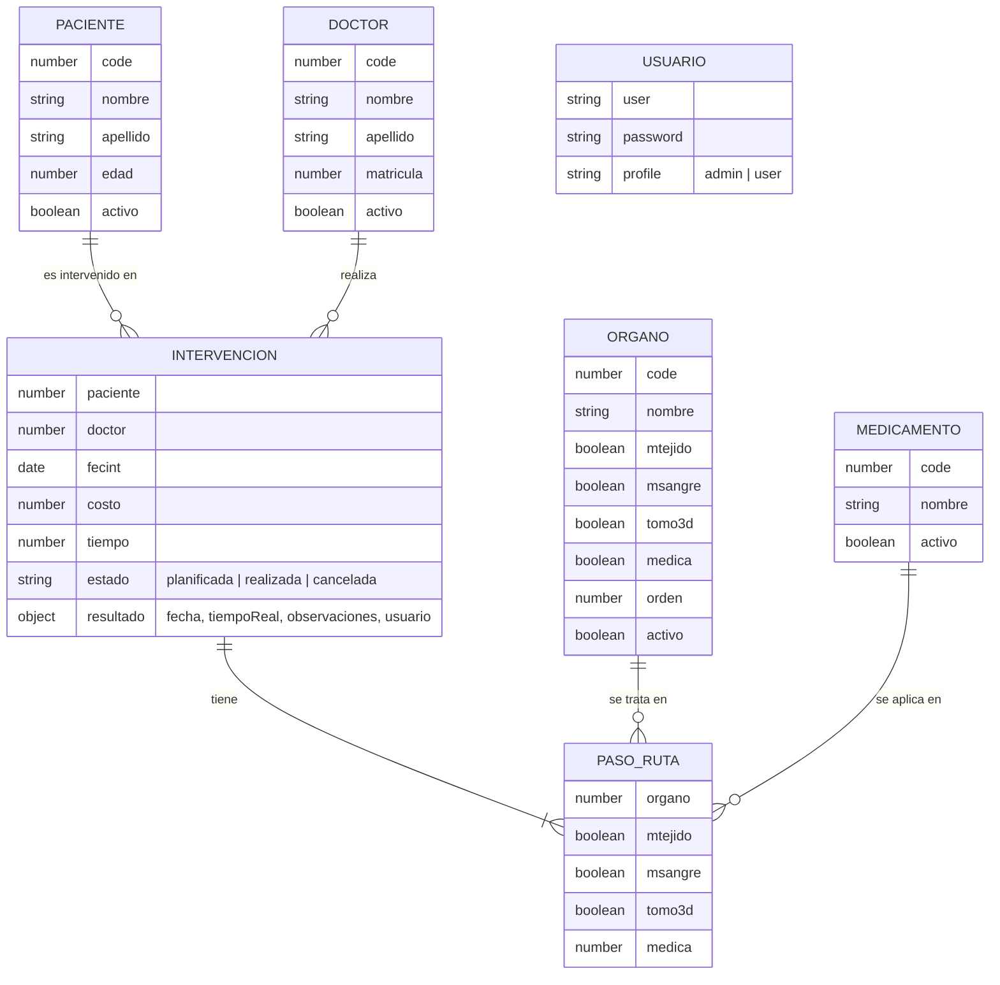

# Propuesta TP DSW

## Grupo
### Integrantes
* COMPLETAR legajo - Apellido(s), Nombre(s)
* COMPLETAR legajo - Apellido(s), Nombre(s)

### Repositorios
* [frontend app](https://github.com/rosariomolinas/FrontEnd)
* [backend app](https://github.com/rosariomolinas/BackEnd)

## Tema
### Descripción
Robiotics es un sistema para un centro de cirugía robótica. Permite registrar pacientes, doctores, órganos y medicamentos, y planificar intervenciones: para cada intervención se elige paciente, doctor y la ruta de órganos a tratar, indicando qué muestras se toman (tejido, sangre, tomografía 3D) y qué medicación se aplica. El sistema calcula el costo y el tiempo estimado de la intervención. Después de la fecha planificada se registra el resultado: si se realizó (con el tiempo real que llevó) o si se canceló (con el motivo).

### Modelo

## Alcance Funcional

### Alcance Mínimo

Regularidad (grupo de 2 integrantes):
|Req|Detalle|
|:-|:-|
|CRUD simple|1. CRUD Paciente 2. CRUD Doctor|
|CRUD dependiente|1. CRUD Intervención {depende de} Paciente, Doctor, Órgano y Medicamento|
|Listado + detalle|1. Listado de intervenciones filtrado por paciente, doctor y rango de fechas, muestra fecha, paciente, doctor, costo y tiempo => detalle muestra la ruta de órganos con las muestras y medicación de cada paso|
|CUU/Epic|1. Planificar una intervención: elegir paciente y doctor, armar la ruta de órganos y obtener costo y tiempo estimados|

Adicionales para Aprobación:
|Req|Detalle|
|:-|:-|
|CRUD|1. CRUD Paciente 2. CRUD Doctor 3. CRUD Órgano 4. CRUD Medicamento 5. CRUD Intervención 6. CRUD Usuario|
|CUU/Epic|1. Planificar una intervención 2. Registrar el resultado de una intervención: sobre una intervención planificada, indicar si se realizó (con el tiempo real) o se canceló (con el motivo). Una vez cerrada ya no se puede modificar|

### Alcance Adicional Voluntario

|Req|Detalle|
|:-|:-|
|Listados|COMPLETAR|
|CUU/Epic|COMPLETAR|
|Otros|COMPLETAR|
